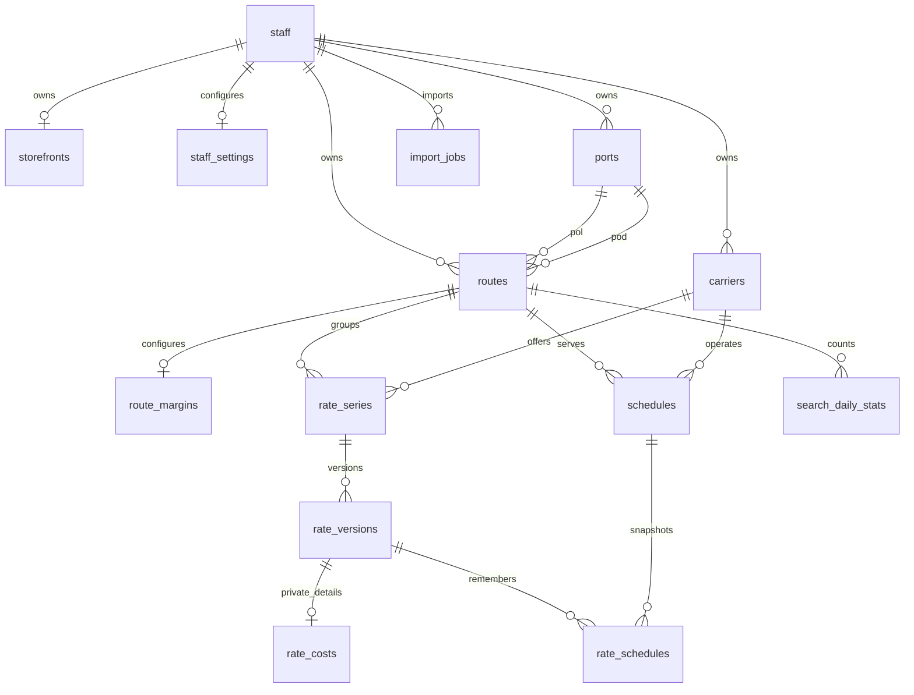

# Thiết kế database PocketBase

Schema thực thi: [`backend/pb_migrations`](../../backend/pb_migrations/).
Quy tắc áp dụng: [business-rules.md](business-rules.md).

## Quy ước

- Mọi collection nghiệp vụ đều có `owner → staff`, `created`, `updated`.
- Mọi relation là single relation, không cascade delete; ưu tiên ngưng sử dụng thay vì xóa danh mục.
- Mỗi bảng dùng ID PocketBase, không dùng mã cảng/hãng làm khóa chính.
- Index unique luôn nằm trong phạm vi owner khi dữ liệu được nhân viên quản lý riêng.
- Records API chỉ cho nhân viên active đọc dữ liệu theo owner; quyền tạo/sửa giới hạn theo
  [ma trận phân quyền](access-control.md). Khách đọc qua custom API với danh sách trường cho phép.
- Trường number tiền mặc định 0 theo PocketBase; service lưu giá phải yêu cầu giá gốc rõ ràng,
  không để thiếu giá đầu vào trở thành giá 0 ngoài ý muốn. Giới hạn schema: 1 tỷ cents/mỗi khoản.

## Collections

| Collection | Dữ liệu chính | Phạm vi dự kiến |
|---|---|---|
| `staff` (auth) | email/password chuẩn PocketBase, name, job_title, phone, active | Riêng; tài khoản nhân viên, không phải superuser |
| `storefronts` | owner, slug, display_name, contact_name/email/phone, zalo_phone, business_hours, default_language, published | Các trường liên hệ khi xuất bản |
| `staff_settings` | default_margin_cents, expiry_warning_days | Riêng |
| `carriers` | code, name, name_en, name_zh, logo, active | Danh mục của storefront |
| `ports` | code nội bộ, unlocode tùy chọn, name/en/zh, country_code, region, can_be_pol/pod, active | Danh mục của storefront |
| `routes` | pol → ports, pod → ports, active | Tuyến thuộc storefront |
| `route_margins` | route, margin_cents | Riêng |
| `rate_series` | route, carrier, container_type, active | Khóa chuỗi giá |
| `rate_versions` | series, revision, is_current, valid_from/to, sell_price_cents, local_charges, surcharges, trade_term, cargo_type, transit_days, service_type, public_note | Giá bán và lịch sử |
| `rate_costs` | rate_version, cost_price_cents, margin_cents, margin_source, internal_note | **Riêng, không công khai** |
| `schedules` | route, carrier, vessel_name, voyage, etd/eta, service_type, transshipment_port, status, public_note, revision | Lịch tàu, kiểm soát sửa đồng thời |
| `rate_schedules` | rate_version, schedule, snapshot JSON | Lịch tàu tại thời điểm lưu giá |
| `search_daily_stats` | route, day, search_count | Riêng; server tăng số đếm |
| `import_jobs` | file_name, status, total_rows, valid_rows, imported_rows, errors/payload/results JSON | Riêng; không lưu file Excel gốc, xóa payload sau commit |

`snapshot` dự kiến gồm `vessel_name`, `voyage`, `etd`, `eta`, `service_type`, `transshipment_port`.
Hook bước sau cần validate và tự tạo snapshot; không nhận JSON tùy ý từ khách.
`import_jobs.errors` có thể chứa giá gốc từ dòng lỗi nên luôn thuộc phạm vi riêng.

## Quan hệ chính

Quan hệ `rate_versions`–`rate_costs`: unique index bảo vệ tối đa 1:1; yêu cầu có đủ cặp bản ghi
được đảm bảo bởi transaction lưu giá. Index hiện hành đảm bảo tối đa một phiên bản;
API lưu giá chuyển cờ và tạo revision mới cùng transaction. Owner lặp lại giúp lọc/phân quyền;
hook server kiểm tra owner của các relation phải khớp nhau và không được đổi owner.

## Index và ràng buộc

- Unique: storefront owner, slug; settings owner; carrier `(owner, code)`; port `(owner, code)`.
- Unique: route `(owner, pol, pod)`; route margin `(owner, route)`.
- Unique: series `(owner, route, carrier, container_type)`; revision `(series, revision)`.
- Unique có điều kiện: một `rate_versions`/series với `is_current = 1`.
- Unique: cost/rate_version; link `(rate_version, schedule)`; stats `(owner, route, day)`.
- Index đọc: owner + validity, owner + route + ETD + carrier, owner + ngày thống kê, owner + thời gian import.
- Tên trạng thái/container/ngôn ngữ dùng select có tập giá trị hữu hạn.
- Mã UN/LOCODE chưa có unique toàn hệ thống vì từng nhân viên có danh mục riêng.

## Ranh giới bảo mật

API rules áp dụng cho endpoint records chuẩn; code custom và superuser phải tự kiểm tra quyền.
Không dùng tài khoản superuser làm tài khoản đăng nhập nhân viên; không đưa token vào frontend.
Khi mở API khách, kiểm tra cả `expand`, back-relation và realtime để bảng riêng không bị lộ.
Không tạo view SQL join giá bán với bảng giá gốc để công khai.

## Migration

| File | Nội dung |
|---|---|
| `1793740800_identity.js` | staff, storefronts, staff_settings |
| `1793740801_catalog.js` | carriers, ports, routes |
| `1793740802_rates.js` | route_margins, rate_series, rate_versions, rate_costs |
| `1793740803_operations.js` | schedules, rate_schedules, search_daily_stats, import_jobs |
| `1793740804_access_rules.js` | Rules nhân viên theo owner; khóa ghi trực tiếp các bảng giá |
| `1793740805_operations_api.js` | Revision lịch tàu, payload/results và số dòng hợp lệ của import |

Mỗi migration chạy trong transaction. Có hàm down theo thứ tự ngược dependency.
**Down xóa collection và dữ liệu**; chỉ dùng thử trên database kiểm thử trống hoặc bản sao.
Database thật thay đổi bằng migration mới và sao lưu trước; không sửa migration đã phát hành.
Catalog seed qua custom API, tách record theo owner; không chạy seed giá trong migration.
Demo có database riêng và password ngẫu nhiên, không có mật khẩu mặc định dùng chung.

Nguồn đối chiếu: [Collections](https://pocketbase.io/docs/collections/),
[API rules](https://pocketbase.io/docs/api-rules-and-filters/),
[JS migrations](https://pocketbase.io/docs/js-migrations/),
[Transactions](https://pocketbase.io/docs/js-database/#transaction).
